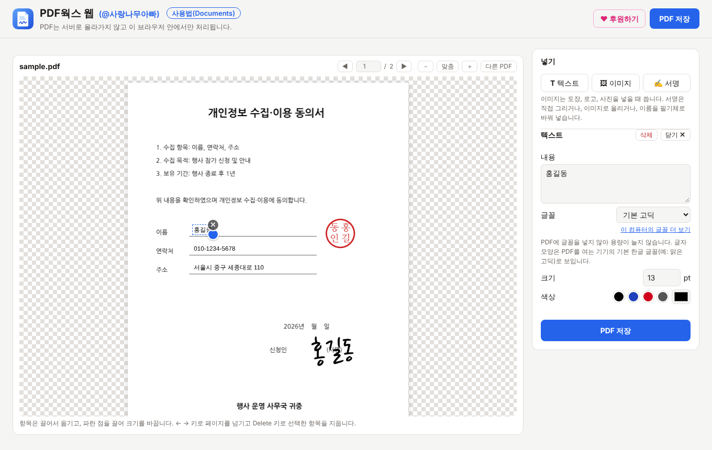
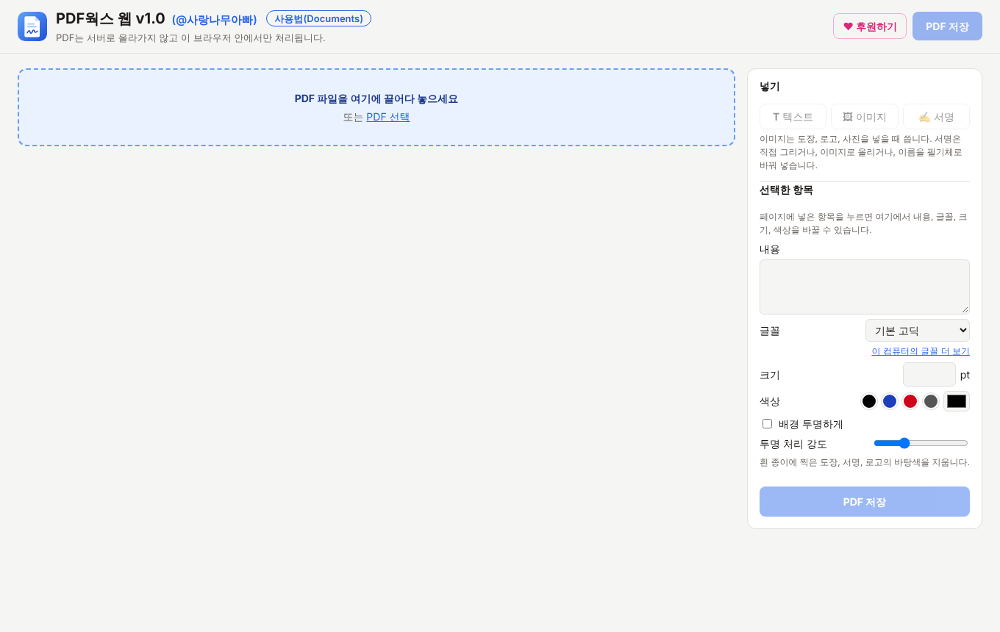
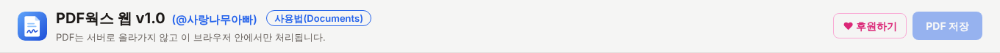
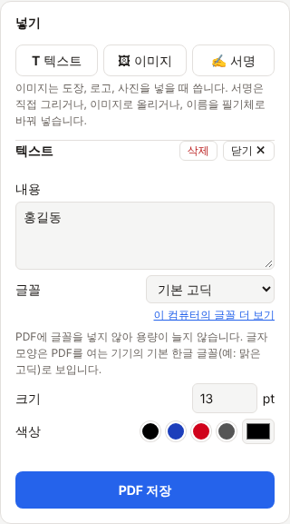
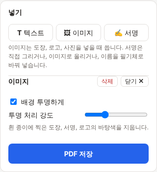
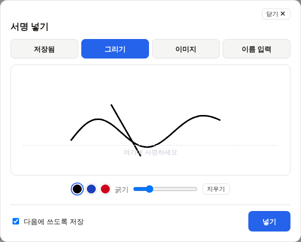
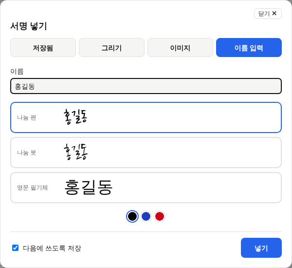
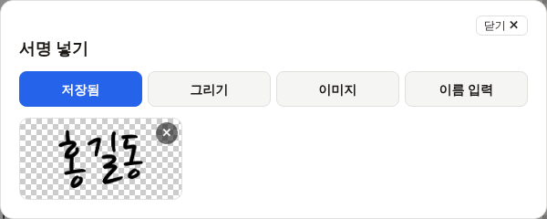
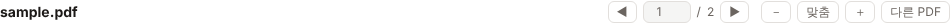
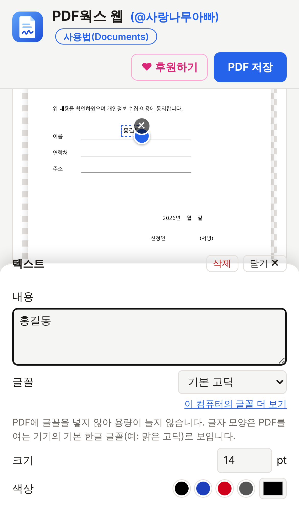

# PDF웍스 웹 v1.0 사용법

PDF 파일에 **글자**, **도장·로고·사진**, **서명**을 넣고 저장하는 브라우저 프로그램입니다.
신청서, 동의서, 계약서처럼 이름을 적고 서명이나 도장을 찍어 보내야 하는 PDF를 프린터 없이 바로 채울 수 있습니다.

**바로 쓰기: https://hupers77.github.io/ProjPDFeditor/**

- 회원가입이나 로그인 없이 주소만 열면 바로 씁니다.
- PDF는 서버로 올라가지 않습니다. 모든 처리는 내 컴퓨터(또는 휴대폰)의 브라우저 안에서만 이루어집니다.
- PC와 휴대폰 모두 됩니다. 휴대폰에서는 손가락으로 옮기고 서명할 수 있습니다.
- 권장 브라우저: **Chrome** 또는 **Edge** (내 컴퓨터 글꼴 불러오기 지원). Whale, Safari, Firefox, 삼성 인터넷에서도 동작합니다.

## 목차

1. [시작하기](#1-시작하기)
2. [화면 구성](#2-화면-구성)
3. [텍스트 넣기](#3-텍스트-넣기)
4. [글꼴 고르기](#4-글꼴-고르기)
5. [이미지 넣기 (도장, 로고, 사진)](#5-이미지-넣기-도장-로고-사진)
6. [서명 넣기](#6-서명-넣기)
7. [옮기기, 크기 바꾸기, 지우기](#7-옮기기-크기-바꾸기-지우기)
8. [여러 페이지 편집하기](#8-여러-페이지-편집하기)
9. [PDF 저장하기](#9-pdf-저장하기)
10. [휴대폰에서 쓰기](#10-휴대폰에서-쓰기)
11. [단축키](#11-단축키)
12. [후원하기](#12-후원하기)
13. [자주 묻는 질문과 한계](#13-자주-묻는-질문과-한계)

---

## 1. 시작하기

1. **https://hupers77.github.io/ProjPDFeditor/** 를 엽니다.
2. 파란 상자에 PDF 파일을 끌어다 놓거나, **PDF 선택**을 눌러 파일을 고릅니다.

---

## 2. 화면 구성

| 위치 | 내용 |
|---|---|
| 상단 제목 줄 | 앱 이름, 만든 이 블로그 링크 **(@사랑나무아빠)**, 이 사용법을 여는 **사용법(Documents)**, 오른쪽에 **♥ 후원하기** 와 **PDF 저장** 버튼 |
| 왼쪽 | 연 PDF가 보이는 곳. 위쪽 줄에서 페이지를 넘기고 확대/축소합니다. |
| 오른쪽 **넣기** | **텍스트**, **이미지**, **서명** 버튼 |
| 오른쪽 **선택한 항목** | 페이지에 넣은 항목을 누르면 내용, 글꼴, 크기, 색상 등을 여기서 바꿉니다. |

---

## 3. 텍스트 넣기

1. 오른쪽 **넣기**에서 **T 텍스트**를 누르면 보고 있는 화면 가운데에 글자 상자가 생깁니다.
2. 오른쪽 **내용** 칸에 글자를 입력합니다. 줄을 바꾸면 여러 줄로 들어갑니다.
3. **글꼴**, **크기**(pt), **색상**을 고릅니다. 색상은 검정, 파랑, 빨강, 회색 버튼을 누르거나 맨 오른쪽 칸에서 원하는 색을 고릅니다.
4. 상자를 끌어서 원하는 자리에 놓습니다.

- 넣은 뒤에도 글자 상자를 다시 누르면 내용, 글꼴, 크기, 색상을 언제든 고칠 수 있습니다. (PC에서는 두 번 누르면 바로 내용 칸으로 갑니다.)
- 마지막에 고른 글꼴, 크기, 색상은 기억해 두었다가 다음 글자 상자에 그대로 씁니다.

---

## 4. 글꼴 고르기

글꼴은 세 묶음 중에서 고릅니다. **저장한 PDF 용량**과 **다른 기기에서 보이는 모양**이 다릅니다.

| 묶음 | 글꼴 | PDF 용량 | 다른 기기에서 열면 |
|---|---|---|---|
| **기본 글꼴** (처음 설정) | 기본 고딕, 기본 명조 | 늘지 않음 | 여는 기기의 기본 한글 글꼴(예: 맑은 고딕, 바탕)로 보임 |
| **글꼴 넣기** | 나눔고딕, 나눔고딕 굵게, 나눔명조, 나눔손글씨 펜, 나눔손글씨 붓 | 쓴 글자만 넣어서 보통 수십 KB 늘어남 | 어디서 열어도 같은 모양 |
| **이 컴퓨터의 글꼴** | 내 PC에 설치된 글꼴 | 쓴 글자만 넣어서 보통 수십 KB 늘어남 | 어디서 열어도 같은 모양 |

- 글꼴을 고르면 그 아래에 어떤 방식인지 짧은 설명이 나옵니다.
- **어떤 걸 고를까요?** 보통은 **기본 고딕**이면 충분합니다. 받는 사람 화면에서도 모양이 꼭 같아야 하거나 손글씨 느낌을 내고 싶으면 **나눔 글꼴**을 고르세요.
- **이 컴퓨터의 글꼴**: PC의 Chrome이나 Edge에서 글꼴 아래의 **이 컴퓨터의 글꼴 더 보기**를 누르세요. 처음 한 번은 브라우저가 글꼴 사용을 허락할지 묻습니다. 허락하면 내 PC에 설치된 글꼴이 목록 맨 아래에 나옵니다.
- PDF에 넣을 수 없는 형식의 PC 글꼴을 고르면 저장할 때 **기본 고딕**으로 바꿔 저장하고 알려 줍니다.

---

## 5. 이미지 넣기 (도장, 로고, 사진)

1. **🖼 이미지**를 누르고 사진 파일(JPG, PNG 등)을 고릅니다.
2. 도장이나 로고처럼 흰 종이에 찍힌 이미지라면 오른쪽에서 **배경 투명하게**를 켭니다. 바탕이 지워져 문서 위에 자연스럽게 찍힙니다.
3. **투명 처리 강도**를 오른쪽으로 옮길수록 바탕을 더 많이 지웁니다. 글자나 도장 테두리까지 지워지면 왼쪽으로 줄이세요.

> 도장을 깔끔하게 넣으려면 흰 종이에 찍은 도장을 밝은 곳에서 위에서 똑바로 찍으세요.

---

## 6. 서명 넣기

**✍ 서명**을 누르면 서명 창이 열립니다. 세 가지 방법으로 서명을 만들 수 있습니다.

### 직접 그리기

**그리기** 탭에서 마우스나 손가락으로 서명합니다. 펜 색(검정, 파랑, 빨강)과 **굵기**를 고를 수 있고, 다시 쓰려면 **지우기**를 누릅니다.

### 서명 이미지 올리기

**이미지** 탭에서 종이에 한 서명을 찍은 사진을 고릅니다. **배경 투명하게**가 켜져 있어서 종이 바탕이 지워집니다.

### 이름 입력 (필기체로 바꾸기)

**이름 입력** 탭에서 이름을 쓰면 여러 필기체로 바꿔 보여줍니다. 마음에 드는 글씨체와 색을 고르세요. 한글은 **나눔 펜**, **나눔 붓**이 어울리고, 영문 이름은 **영문 필기체**가 어울립니다.

### 서명 저장해 두기

**다음에 쓰도록 저장**이 켜진 채로 **넣기**를 누르면 서명이 저장됩니다. 다음부터는 **저장됨** 탭에서 눌러 바로 넣을 수 있습니다. 필요 없는 서명은 ✕ 를 눌러 지웁니다.

> 저장한 서명은 **지금 쓰는 브라우저에만** 남습니다. 다른 컴퓨터나 휴대폰, 다른 브라우저에서는 보이지 않고, 브라우저의 방문 기록(사이트 데이터)을 지우면 함께 지워집니다. 서버로는 보내지 않습니다.

---

## 7. 옮기기, 크기 바꾸기, 지우기

- **옮기기**: 항목을 누른 채 끌어서 옮깁니다.
- **크기 바꾸기**: 항목을 누르면 오른쪽 아래에 **파란 점**이 생깁니다. 이 점을 끌면 크기가 바뀝니다. 이미지와 서명은 가로세로 비율을 지킨 채 커지고 작아지며, 글자 상자는 글자 크기가 바뀝니다.
- **지우기**: 항목 오른쪽 위의 **✕**, 또는 오른쪽 **선택한 항목**의 **삭제**를 누릅니다.
- **선택 풀기**: 페이지의 빈 곳을 누르거나 **닫기 ✕**를 누릅니다.

---

## 8. 여러 페이지 편집하기

| 버튼 | 하는 일 |
|---|---|
| ◀ ▶ | 이전 / 다음 페이지 |
| 숫자 칸 | 페이지 번호를 적으면 그 페이지로 갑니다. |
| － ＋ | 축소 / 확대 |
| 맞춤 | 페이지를 화면 너비에 맞춥니다. |
| 다른 PDF | 다른 PDF 파일을 엽니다. (지금까지 편집한 내용은 사라지니 먼저 저장하세요.) |

페이지마다 넣은 항목은 따로 기억되므로, 페이지를 넘기며 차례로 채운 뒤 한 번에 저장하면 됩니다.

---

## 9. PDF 저장하기

오른쪽 위 또는 오른쪽 아래의 **PDF 저장**을 누르면 편집한 PDF가 다운로드됩니다.

- 파일 이름은 `원래이름_편집.pdf` 입니다. (예: `동의서.pdf` → `동의서_편집.pdf`)
- 원래 PDF 파일은 바뀌지 않습니다.
- 넣은 글자는 그림이 아니라 글자로 들어가므로, 저장한 PDF에서도 글자를 검색하거나 복사할 수 있습니다.
- 저장하기 전에 창을 닫거나 새로고침하면 편집한 내용이 사라집니다. (닫으려 하면 브라우저가 한 번 물어봅니다.)

---

## 10. 휴대폰에서 쓰기

- 같은 주소를 휴대폰 브라우저에서 엽니다.
- 항목을 누르면 설정 창이 화면 아래에서 올라옵니다. 다 고친 뒤 **닫기 ✕**를 누르면 내려갑니다.
- 항목은 손가락으로 끌어 옮기고, 파란 점을 끌어 크기를 바꿉니다.
- 서명은 **그리기** 탭에서 손가락으로 쓰면 됩니다.

---

## 11. 단축키 (PC)

| 키 | 하는 일 |
|---|---|
| ← → (또는 PageUp, PageDown) | 이전 / 다음 페이지 |
| Delete, Backspace | 선택한 항목 지우기 |
| Esc | 선택 풀기 |

---

## 12. 후원하기

이 프로그램이 도움이 되셨다면 상단의 **♥ 후원하기**로 커피 한 잔 응원해 주세요.

- **카카오페이**: 휴대폰에서는 **카카오페이로 5,000원 송금하기** 버튼을 누르면 바로 송금 화면이 열립니다. 컴퓨터에서는 휴대폰 카메라로 QR 코드를 찍으세요.
- **GitHub Sponsors**: 해외 후원자를 위한 GitHub Sponsors는 준비 중입니다.

---

## 13. 자주 묻는 질문과 한계

**내 PDF가 어딘가로 전송되나요?**
아니요. PDF, 이미지, 서명 모두 내 브라우저 안에서만 처리되고 어디에도 보내지 않습니다. 인터넷은 이 사이트의 화면과 글꼴 파일을 받을 때만 씁니다.

**기본 글꼴로 저장했더니 다른 컴퓨터에서 글자 모양이 달라요.**
기본 글꼴은 PDF 용량을 늘리지 않으려고 글꼴을 넣지 않고, 여는 기기의 한글 글꼴로 보여 줍니다. 그래서 기기마다 모양이 조금 다를 수 있고, 한글 글꼴이 없는 아주 드문 기기에서는 글자가 안 보일 수 있습니다. 모양이 꼭 같아야 하면 **나눔 글꼴**을 고르세요.

**암호가 걸린 PDF는요?**
열기 암호가 걸린 PDF는 열 수 없습니다.

**PDF에 원래 있던 글자를 고치거나 지울 수 있나요?**
아니요. 이 프로그램은 PDF 위에 글자, 이미지, 서명을 **덧붙이는** 용도입니다. 원래 내용은 바꾸지 않습니다.

**저장한 PDF를 다시 열어서 넣었던 글자를 고칠 수 있나요?**
저장한 뒤에는 넣은 항목이 PDF의 일부가 되어 다시 고칠 수 없습니다. 저장하기 전에 확인하세요. 고쳐야 하면 원래 PDF를 다시 열어 처음부터 넣으면 됩니다.

**이 컴퓨터의 글꼴 더 보기가 안 보여요.**
PC의 Chrome, Edge에서만 지원합니다. 휴대폰이나 Safari, Firefox에서는 기본 글꼴과 나눔 글꼴을 쓰세요.

**문의나 오류 신고는 어디로 하나요?**
[@사랑나무아빠 블로그](http://blog.naver.com/hupers)로 알려 주세요.

---

사용한 글꼴: 나눔고딕, 나눔명조, 나눔손글씨 펜·붓 (© NAVER), Dancing Script. 모두 무료 글꼴(SIL Open Font License)입니다.
